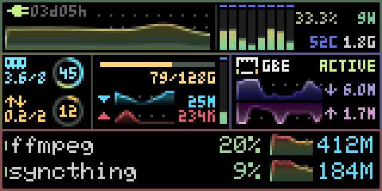
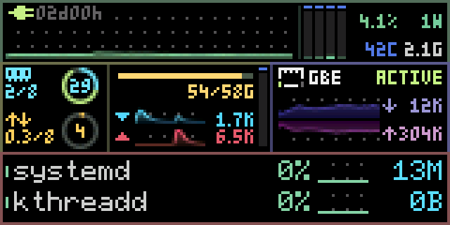

# msutop

## Overview

**面向 160×80 RGB565 显示屏的小型系统监控器。** msutop 把 CPU、内存、磁盘、
网络和主要进程放进一张持续更新的画面，并能以接近 30 FPS 的速度直接驱动
真实 MSU 屏幕。所有指标始终同时可见，无需翻页。

Rust 实现，支持 SDL2 桌面预览、Linux 真实监控、原始 RGB565 帧导出和串口输出。
Windows 可直接下载运行，用模拟数据查看界面；Linux 可采集实际系统指标。



## Quick Start

从 [最新 Release](https://github.com/StevenArai/msutop/releases/latest) 页面下载
**Windows x86_64 ZIP 包**，完整解压后双击 `00-PREVIEW.cmd`，或在解压目录运行：

```powershell
.\msutop.exe
```

发布包已包含程序、`SDL2.dll`、启动脚本和说明，无需安装 Rust 或 Python。
请把 DLL 留在 EXE 旁边。参数、按键和串口使用方法见
[Windows 使用说明](docs/windows.md)。

## Features

| 区域 | 同时显示的指标 |
|---|---|
| CPU | 历史曲线、每线程柱、利用率、频率、功耗、温度、运行时间 |
| 内存与 swap | 已用／总量与环图；内存缓存段；可用空间不足告警 |
| 磁盘 | 容量、实时读写速率、IO 曲线、队列深度、温度 |
| 网络 | 实时上下行、流量曲线、链路速率、连接状态、连接与活动灯 |
| 进程 | 按 CPU 占用选择的两个主要进程，显示名称、CPU、内存占用和曲线 |

默认每秒更新 30 次数据；曲线、柱和环支持抗锯齿，字体与图标保持清晰像素。
CPU 柱数跟随逻辑线程数，左侧曲线自动利用剩余宽度。数值变化经过平滑处理，
进程名称在小幅排名变化时保持稳定。

模拟数据（mock）包含正常、空闲、CPU 忙碌、磁盘忙碌、内存紧张和断网场景，
便于在没有屏幕或 Linux 主机时调试。它们使用相同布局，场景由用户手动选择。
布局、配色及视觉实现见 [视觉设计](docs/design.md)。

## Linux Live Monitoring

Linux 加 `--live` 读取真实系统数据，无需 GUI。按下方
[Build & Test](#build--test) 编译后，可先记录十秒画面：

```sh
./target/release/msutop --live --headless --seconds 10 --rgb565 frames.rgb565
```

CPU、内存、磁盘、网络和进程来自 `/proc` 与 `/sys`。网卡默认跟随默认路由，
磁盘从挂载点解析底层设备；可用 `--interface eth0 --disk sda --mount /` 指定。
缺失传感器显示 `--`。可选辅助进程支持读取 RAPL 功耗和 SMART 磁盘温度。

采集频率、进程选择和指数移动平均（EMA，一种减少数值抖动的平滑方法）见
[采集与数据处理](docs/telemetry.md)。

## MSU Display

`--msu PORT` 把完整监控画面发送到 MSU 屏幕，保留 RGB565 颜色、渐变和抗锯齿。
**设备固件须支持 R / RGB565 v1 图像协议**，首次连接前处于终端模式；
仅有串口连接不足以保证兼容。

```sh
# Linux 真实监控；替换为设备的实际串口
./target/release/msutop --live --msu /dev/ttyACM0 --seconds 30
```

每次完整发送一帧，流水写出后核对设备回复，再开始下一帧。退出保留最后画面。
续传与模式切换见 [串口协议说明](docs/rgb565.md)；Windows 发送模拟画面见
[Windows 使用说明](docs/windows.md#接-msu-屏幕)。

### 真实硬件短测

测试平台：四线程 Celeron J1900 / PVE，真实系统采集并发送到屏幕，时长 **20.024 秒**。

| 测量 | 结果 |
|---|---:|
| 平均完成帧率 | **29.664 FPS** |
| 主进程单核 CPU 占用 | **6.370%** |
| 完成帧数 | **594** |
| 匹配的设备确认回复（ACK） | **6,534** |

全部传输回复匹配，实物颜色已确认正确。157 帧超过 33.33ms 工作预算；
这是一段短测，不表示每帧恒定 30 FPS，也不替代长期稳定性测试。
CPU 指标不包含独立传感器辅助进程。完整方法、分项耗时及原始报告见
[性能记录](docs/performance.md)。



这段历史录制使用发布前的字体；当前字体见上方预览。

## Build & Test

需要 Rust 1.88 或更新版本。Windows 安装 Rustup 和 Git 后，在仓库根目录运行：

```powershell
.\scripts\preview.ps1 -BuildOnly -Check
.\target\release\msutop.exe
```

脚本使用 GNU／MinGW 工具链，下载并校验官方 SDL2，同时运行测试。
Linux 无 GUI 构建和检查：

```sh
cargo build --release --no-default-features --features serial --locked
cargo test --locked --all-targets --no-default-features --features serial
cargo clippy --locked --all-targets --no-default-features --features serial -- -D warnings
```

Linux 窗口预览需安装 SDL2 开发库，再启用 `sdl,serial` 构建。
Windows 发布包重建见 [构建说明](docs/windows.md#从源码构建)。

## Documentation

| 文档 | 内容 |
|---|---|
| [Windows 使用说明](docs/windows.md) | 下载、参数、按键、串口与构建 |
| [采集与数据处理](docs/telemetry.md) | Linux 指标来源、进程选择、平滑和传感器 |
| [视觉设计](docs/design.md) | 单屏布局、配色、连续滚动与抗锯齿 |
| [串口协议](docs/rgb565.md) | 固件要求、全帧传输、握手和回复校验 |
| [性能记录](docs/performance.md) | J1900 实机短测、计时边界与原始报告 |
| [来源与授权](NOTICE.md) | 字体、配色和依赖的许可情况 |

## License

msutop 原创代码采用 [MIT](LICENSE)。6×8 字符格使用 Adafruit GFX 的 BSD 字体，
SDL2、btop 配色和串口库保留各自的许可。

3×5 字模由 StevenArai 为 credits_vfd 制作和调整，参考设计的原始来源不可考；
MIT 覆盖作者自身贡献。完整来源说明见 [NOTICE.md](NOTICE.md#3x5-values)。
