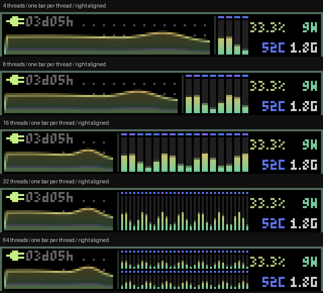

# msutop

一张固定的 **160×80 RGB565 系统监控画面**，Rust 实现，支持 SDL 窗口预览和
MSU 屏幕串口输出。CPU 曲线、每线程柱、利用率／频率／功耗／温度，内存与 swap
双环、磁盘容量／IO／队列／温度，网络上下行和两个主要进程始终同时可见。

曲线、柱和环支持抗锯齿；进程名称与数值使用 6×8 字符格，其余数值使用
credits_vfd 的 3×5 字模。默认数据刷新 30Hz，SDL 呈现跟随显示器 VSync。
没有定时翻页，也不把总览与细节分开。


## Windows 下载与运行

下载 [最新 Release](https://github.com/StevenArai/msutop/releases/latest) 的
`msutop-v0.1.0-windows-x86_64.zip`，完整解压后双击 `00-PREVIEW.cmd`，或在该目录运行：

```powershell
.\msutop.exe
.\msutop.exe --mock-threads 4 --scale 6 --fps 30
.\msutop.exe --scene cpu --theme vivid
.\msutop.exe --no-aa
```

发布包包含 EXE、`SDL2.dll`、启动脚本和使用说明，无需安装 Rust 或 Python。
请把 DLL 留在 EXE 旁边。构建采用 **Windows x86_64 GNU／MinGW**。
Windows 使用 mock 数据预览；Linux 加 `--live` 开启真实采集。
完整 [Windows 使用说明](docs/windows.md) 包含所有常用参数、串口和构建方法。

| 按键 | 操作 |
|---|---|
| 空格 | 暂停／继续 |
| 1..6 | 手动切换 mock 工作负载 |
| N | 网卡状态 |
| T | 配色 |
| A | 抗锯齿 |
| Q | RGB565／RGB888 对比 |
| + / - | 整数放大倍数 |
| Esc | 关闭 |

`--mock-threads N` 支持 1..512 个逻辑线程。每线程独立一根柱，右对齐；左侧
CPU 曲线根据柱数调整宽度。`--scene` 支持 balanced／idle／cpu／io／memory／offline。
网卡模型区分 DOWN、NOCARRIER、ACTIVE 空闲和 ACTIVE 传输；活动灯保留短包间隙
的闪烁相位。所有工作负载使用相同单屏布局。



## Linux 真实采集

无需 GUI，Rust 1.88 或更新版本：

```sh
cargo build --release --no-default-features --features serial --locked
# 记录十秒原始画面；每帧 25,600 字节，大端 RGB565
./target/release/msutop --live --headless --seconds 10 --rgb565 frames.rgb565
# 接 MSU 屏幕；需要 R / RGB565 v1 固件及终端模式
./target/release/msutop --live --msu /dev/ttyACM0 --seconds 30
```

CPU、内存、磁盘和网络直接读取 `/proc` 与 `/sys`；每秒扫描全部进程用于 CPU-lazy
选择，显示的两个进程按帧率更新。EMA 平滑数值和自动量程，固定历史节点用连续
亚像素平移滚动，格点保持不动。`--no-ema` 可查看原始采样。

网卡默认跟随默认路由；磁盘从挂载点解析底层物理设备。可用
`--interface eth0 --disk sda --mount /` 指定。缺失传感器显示 `--`。
可选 `--sensor-helper scripts/linux-sensors.py` 每秒读取 RAPL 功耗、每五秒读取
SMART 温度；需要 Python 3 和 smartctl 以及相应设备读取权限。辅助进程在帧循环外
运行，不唤醒待机盘；`--sensor-sudo` 使用现有非交互 sudo 权限。

Linux SDL 预览可安装 SDL2 开发库后运行 `cargo run --features sdl,serial -- --live`。

## MSU 屏幕

`--msu PORT` 使用与
[RAW_DIRECT_POC.py](https://github.com/StevenArai/msu-rust/blob/main/RAW_DIRECT_POC.py)
相同的 **R / RGB565 v1、RAW FULL + pipeline**：每帧覆盖整个屏幕，十个 8 行 RAW
条带和 COMMIT，共 25,875 字节，随后核对全部 11 个 ACK。不压缩、不差分、不降色。

```powershell
# Windows 发送 mock 画面；替换为实际 COM 号
.\msutop.exe --msu COM5 --seconds 30
# 已确认 R 模式的同一设备续传
.\msutop.exe --msu COM5 --msu-ready --seconds 30
```

不指定 `--seconds`／`--frames` 时串口模式只发一帧。退出保留最后画面，设备复位
回终端后重新握手；`--msu-ready` 仅用于已确认的 R 会话。错误后停止，不积压追赶帧。
R 协议是 msu-rust 固件的图像接口；原厂旧 N 命令接口保留为 `--rawfb` 兼容入口，
需按目标固件验证。当前完整颜色输出使用 R。详见 [协议与实测](docs/rgb565.md)。

四线程 Celeron J1900 的真实 PVE 采集及串口短测：20.024 秒完成 594 帧，平均
**29.664fps**，全部 ACK 匹配，主进程占用单核 6.370%。157 帧超过 33.33ms
工作预算，未承诺每帧恒定 30fps。实物颜色已确认正确。
以下历史录制使用发布前的字体；当前 Release 字体见上方预览。


## 从源码构建

Windows 安装 Rustup 和 Git 后，在仓库根目录：

```powershell
.\scripts\preview.ps1 -BuildOnly -Check
.\target\release\msutop.exe
.\scripts\package-windows.ps1 -SkipBuild
```

脚本配置 GNU Rust 1.88 工具链，下载并校验官方 MinGW SDL2，启用 `sdl,serial`。
`target\gnu` 存放编译缓存；`target\release` 提供可直接运行的 EXE 和 DLL。
Windows 交叉构建 Linux musl：`scripts/build-linux.ps1`。

```sh
cargo test --locked --all-targets --no-default-features --features serial
cargo clippy --locked --all-targets --no-default-features --features serial -- -D warnings
```

可用 `--profile file.json --seconds 10` 记录采集／渲染／输出开销。
导出静态帧使用 `--export output`；生成 PNG／GIF 的
`scripts/render-preview.py` 额外需要 Pillow。布局与行为细节见 [视觉设计](docs/design.md)。

## 许可证与来源

msutop 原创代码采用 [MIT](LICENSE)。6×8 字符格使用 Adafruit GFX 的 BSD 字体，
3×5 字体使用用户提供的 credits_vfd 字模；字体、btop 配色和依赖归属见
[NOTICE.md](NOTICE.md)。SDL2 保留 zlib 授权，serialport 保留 MPL-2.0。
第三方许可文本随源码和 Windows 发布包提供。
