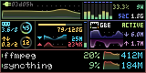
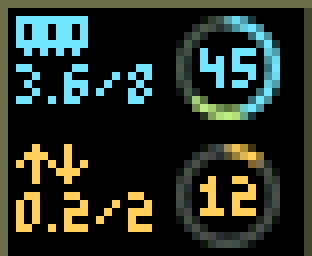
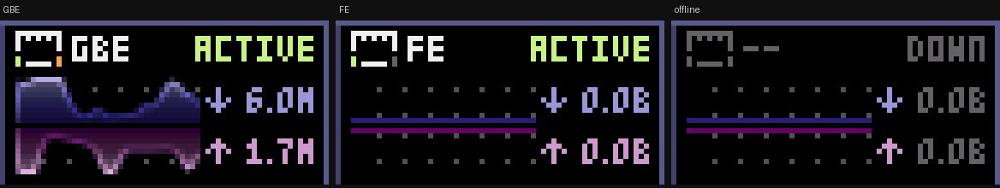
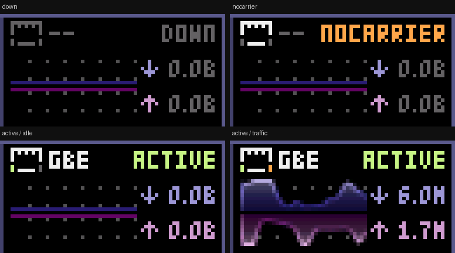
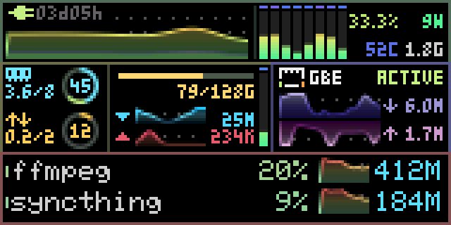
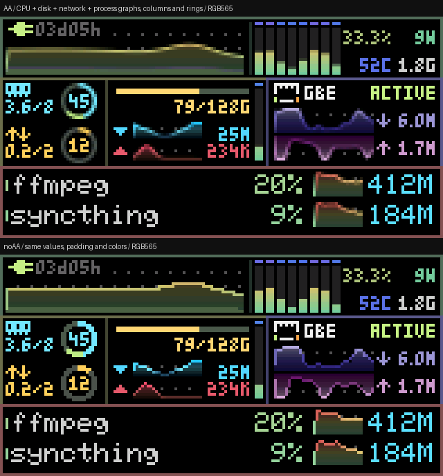

# 单屏视觉与行为

160×80 的原始帧：

| 固定区域 | 同时可见的信息 | 像素表达 |
|---|---|---|
| CPU，160×22 顶带 | 左上角依次为插头、uptime（如 03d05h）；从左到右为历史曲线、每线程柱、两行数字：利用率／W，温度／GHz | 左侧曲线高 19px、宽度随线程柱组调整；左上为绿色 9×5 插头与 3×5 运行时间留出带 1px 间距的固定底色，底层区分 system／IO wait。线程柱右对齐，每个逻辑线程独立显示，不合并取平均；常规柱为 3×17，上方留 1px 间隔的温度 indicator；线程较多时收细、分行。四个数值按两列右对齐，列间至少 1px |
| 内存，左中 38×31 | 9×5 内存芯片／交换箭头图标，下方分别是已用／总量（GiB）；右侧环内为已用百分比 | 13×13 小环纵向排列，中间有 3 行空隙；容量与圆环之间至少 1px；数字与环心对齐。青色 used 的末端追加绿色 cached，长度按实际容量比例，free 为灰深绿；swap 已用为黄色，余量为灰深绿。可用内存或 swap 低于 10% 时使用更亮的警示红 |
| 磁盘，中间 58×31 | 容量已用／总量、▼ 读速、▲ 写速、队列深度、温度 | 顶部使用条为 48×2，无描边，位于 (42,26)，上移 1px；可用部分为提亮的灰绿。两条 25×6 曲线与 3×5 速率数值各有固定空间，读速和下三角已下移 1px 对齐；右侧队列深度柱宽 3px，固定 0–8 刻度，超过 8 时柱体封顶；上方 3×1 色条表示温度，与柱体相隔 1px |
| 网络，右中 64×31 | 9×7 以太网图标、FE／GBE、状态文字、连接及活动灯、实时上下行 | FE／GBE 右边固定显示灰色 DOWN、橙色 NOCARRIER 或绿色 ACTIVE，统一使用 3×5 字体并右对齐；传输状态仍显示 ACTIVE。网口左下为绿色连接灯，右下为橙色活动灯，熄灭均为灰色，每盏灯有 1px 黑边。36×9 紫色下载面积图向上展开，粉色上传面积图向下展开，中间留 1 行空隙；图表右侧为方向箭头和字节／秒速率，K／M／G 为量级。无 /s 字样，无累计流量 |
| 进程，底部两行 | 两个进程名称、CPU%、RSS | 名称、CPU、RSS 统一使用 6×8；名称空间扩为 13 字符，超长名称结尾用 ~。CPU 数字右边界为 x=110，18×9 曲线从 x=113 开始，RSS 右对齐至 x=157。省下的进程总数／线程数字段空间用于名称；两图间留 2px 空隙，文字行距保持 11px，数值列间保留 2px |

进程面板底边在 y=79 闭合，与顶部和侧边使用同一种颜色；内容与底边间保留空行。

容量会在固定字符预算内降低小数精度或升级单位，保持分母和单位可见。6×8 字体和 3×5 字体均保留原始字模及位序，覆盖 ASCII 0x20–0x7E；其他字符显示 `?`。温度等数据缺失时在原位显示 `--`。GPU 已从数据模型和画面移除。

运行时间按实际时长自动显示 `xxs`、`xxmxxs`、`xxhxxm`、`xxdxxh` 或 `xxwxxd`，每个数字段固定两位、左侧补零。例如 `09s → 01m00s`、`59m59s → 01h00m`、`23h59m → 01d00h`、`06d23h → 01w00d`。显示槽位固定，进位不会挤动 CPU 曲线；两位周数达到上限后封顶显示 `99w06d`。

内存区按参考图布局，用芯片与交换箭头替代 mem／swap 字样，容量和环内百分比统一使用指定的 3×5 字体。容量例如 3.7/8 和 1.1/2 表示 GiB；更大容量按字符预算缩写。已用段、数字和内存图标恢复为青色 `#74E6FC`，短缺告警仍为红色。

硬盘和网络速率在选定单位下，小于 10 始终保留一位小数，包含 1.0、6.0、0.0；10–999 显示整数，例：`9.9M`、`1.0M`、`10M`、`999M`。单位按 1024 进位；进位边界避免四位数字挤入曲线区域。速率栏最多 15px 宽。

网卡模型区分 down、nocarrier、active 空闲、active 传输四种状态。down 时图标为灰色；nocarrier 时图标亮、两灯灰；active 时左灯绿色常亮。白边使用原来的 9×7 网口轮廓，两灯位于左右下角，1px 黑边直接覆盖白色下角。右灯按 100ms 亮／100ms 灭闪烁，包间空档不超过 250ms 时保持原相位，避免真实的 30Hz 采样反复重新点灯。持续无包超过 250ms 后灭灯，无载波或关闭时立即熄灭；暂停预览时不推进计时。mock 空闲与断网场景分别为 active 空闲与 down，其他工作负载默认为传输。使用 `--network down|nocarrier|active|transfer` 或窗口 `N` 手动调试，监控布局始终不变。进程区的顶部和两侧使用一致的边框颜色。

可用内存定义为 `free + cached`，低于总内存 10% 时该内存的图标、容量、used 段和环内数字转红；cached 继续绿色。剩余 swap 低于 swap 总量 10% 时 swap 图标、容量、已用段和环内数字转红。两种告警独立判断；总量未知或未启用 swap 不触发告警。

### 进程名称的稳定显示

按 CPU 占用选择两个主要进程；小幅排名变化不会反复交换名称位置。
采样、排名平滑及替换条件见 [进程选择与数据处理](telemetry.md#进程选择)。

### 更新与连续滚动

默认每秒采集 30 次数据，数字随新样本更新。SDL 窗口按显示器垂直同步（VSync）
呈现，例如 60Hz；每次呈现都根据实际经过时间推进曲线位置，数据采集仍是 30Hz。
没有 VSync 时使用定时软件预览，延迟后不补画一串追赶帧。

每条曲线按固定时间桶生成节点；默认保留 128 个样本，覆盖约 4.23 秒。
完成节点的高度和当时量程保持不变，用连续的亚像素位移向左滚动，即每帧可以
移动小于一个像素的距离。跨时间桶不重新采样整条历史，避免曲线滚动时来回变形。
最右侧的新节点及连接线可随新数据改变，左侧保留屏幕外节点以维持连续连接。

格点固定在屏幕位置，仅绘制于未被曲线或面积覆盖的黑底像素。
抗锯齿通过线段与像素的连续距离计算覆盖率，让小于一个像素的位移也能呈现；
字体、图标和面板边框保持清晰像素。图表自动量程的平滑规则见
[采集与数据处理](telemetry.md#数值与量程平滑)。

### 颜色

`default` 来自 [btop 内置 Default_theme](https://github.com/aristocratos/btop/blob/fd1d2920e5442045f89b8991cca4c3c503ff48f6/src/btop_theme.cpp)，已用 `--depth=1` 获取上游核对。CPU 的三个色标是 `#77CA9B → #CBC06C → #DC4C4C`。

`vivid` 保留其余默认配色，并使用指定的 **`#50F095 → #F2E266 → #FA1E1E`** CPU 渐变。所有输出默认量化到 RGB565 后预览。

### AA 与 noAA 对照

CPU、硬盘、网络和进程曲线均按一像素宽的固定线段计算连续距离覆盖率，避免有限子像素采样再次把平移量化成台阶。CPU 核心柱和硬盘队列柱保留小数高度，用部分覆盖的顶边像素表达高度变化。双环内外轮廓及扇区交界使用 4×4 覆盖率；角度与圆形遮罩启动时预计算，帧内只分类和混色。字体、图标、直角边框、温度 indicator 和使用条保持清晰像素。最终输出统一量化到 RGB565。

窗口按 `A` 即时对比；命令行 `--no-aa` 或启动脚本 `-NoAA` 关闭。`docs/aa-comparison.png` 是同一 mock 时刻、同一 RGB565 颜色下的两种实际帧。

内存正常时的已用段与容量数字为青色 `#74E6FC`，缓存段使用 btop free 渐变的绿色；内存 free 底环与硬盘使用条可用部分为提亮的灰绿 `#4A584F`，swap 底环为 `#4B514D`。短缺时使用更亮的 `#FF4769`。活动灯与 nocarrier 文字为橙色 `#FFA64D`。

CPU、网络、硬盘和进程图表不铺独立背景，沿用屏幕黑底；格点为提亮的 `#505050`，间距为 5px。CPU 格点从原始画面的 (6,6) 开始；网络上下行格点围绕中间空行镜像排列。格点只显示在没有曲线或面积填充的黑底上；左上角插头与运行时间使用屏幕底色，覆盖其下的 CPU 格点。

