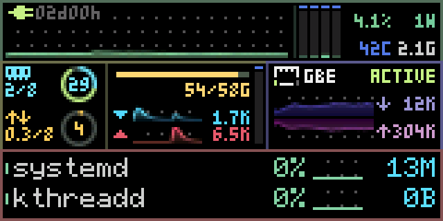

# 真实硬件性能记录

2026-11-03，在四线程 Intel Celeron J1900 / PVE Linux 主机上运行真实采集、EMA
平滑和抗锯齿，并通过 `/dev/ttyACM0` 把完整 RGB565 帧发送到 MSU 屏幕。
原始机器可读报告见 [pve-r-full-profile.json](pve-r-full-profile.json)。

## 完成结果

| 指标 | 实测 |
|---|---:|
| 运行时间 | 20.024 秒 |
| 目标帧率 | 30 FPS |
| 平均完成帧率 | **29.664 FPS** |
| 主进程单核 CPU 占用 | **6.370%** |
| 完成帧数 | **594** |
| 匹配 ACK 数量 | **6,534** |
| 发送字节 | 15,369,750 |
| 接收字节 | 78,408 |
| 超过 33.33ms 工作预算的帧 | **157** |

ACK 是设备的确认回复，594 帧的全部回复均匹配。屏幕颜色已由用户确认正确。
该测试包含真实 Linux 指标、图表渲染、RGB565 文件记录和设备传输。
传输每帧覆盖全屏，未压缩、差分、降色或填充模拟数据。

## 分项耗时

| 每帧阶段 | 平均 | p95 |
|---|---:|---:|
| 采集 | 0.649ms | 0.454ms |
| 渲染 | 0.467ms | 0.535ms |
| 输出（编码、记录、发送及等待回复） | 32.144ms | 32.805ms |
| 完整工作周期 | 33.272ms | 33.846ms |

采集均值高于 p95 是因为低频的全进程扫描和传感器读取形成少量较大样本；
采集最大值为 9.656ms。工作周期 p99 为 41.384ms，最大 41.929ms。
传输已经接近 33.33ms 预算，叠加采集与扫描后，部分帧超过工作预算。

主进程使用单核时间归一化的 CPU 百分比，不能直接当作整机总 CPU 百分比。
其中输出模块占单核 2.925%，包含 RGB565 编码和串口系统调用。独立 Python
传感器辅助进程及 smartctl 的 CPU 不计入主进程 6.370% 指标。

该次运行启动了独立功耗／SMART 温度辅助进程。图像提交的 ACK 在固件同步
显示调用返回后产生；它确认协议处理完成，不测量面板光学扫描完成时刻。
FPS 统计从主监控循环开始到结束，首次握手与软件复位不计入。

这是一段约 20 秒短测，说明该平台和固件下平均完成速度接近 30 FPS；
不表示每帧恒定 30 FPS，也不替代长时间稳定性测试。性能值来自这次原始报告，
不能据此保证其他主机、固件或负载有相同结果。

## 记录画面与验证边界

下图从该次实际发送的原始帧生成，按记录时间戳保留速度。为了控制 GIF 大小，
跳过约 4.3 秒预热，取 450 帧，共约 15.17 秒；GIF 使用 10ms 时间刻度。
这段历史录制使用发布前的 Linux 6×8 字体；当前 Release 的 6×8 字符格使用 BSD 字体。
字体调整不改变串口协议。

完整 RGB565 记录 SHA-256：
`e334a1dc05e5207a514f339b28510c60587d66723808225ea7567b22db6f1bd0`。

协议离线验证包含全帧逐像素编码、CRC、短读写、帧号回绕，以及错序、重复、
拒绝、缺失或额外回复之后停止。两帧 Rust 输出与参考 Python 打包器逐字节一致，
共 51,750 字节；相同输出通过真实固件解析器的 1／7／64／128／255 字节拆包验证。
实现和复现入口见 [串口协议](rgb565.md)。
