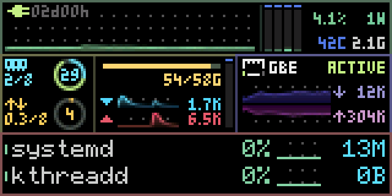

# MSU RGB565 全帧直传

`--msu PORT` 复用 [RAW_DIRECT_POC.py](https://github.com/StevenArai/msu-rust/blob/main/RAW_DIRECT_POC.py) 的传输约定，Rust 实现位于 [src/rgb565.rs](../src/rgb565.rs)。它通过 `FrameSink` 获取 msutop 的完整 160×80 帧，使用 R / RGB565 v1 的 RAW FULL + pipeline。监控配色与帧缓冲的 RGB565 数值保持一致。

每帧发送十个 8 行条带和一次 COMMIT，总计 25,875 字节。包头沿用 [msu_host/rgb565.py](https://github.com/StevenArai/msu-rust/blob/main/msu_host/rgb565.py) 的 `<4sBBHHHHBHII`；各条带载荷为 2,560 字节的大端 RGB565。RAW 的载荷 CRC 和明文 CRC 相同，使用 CRC-32/ISO-HDLC。COMMIT 的 band=10，长度和 CRC 全部为零。

整个帧一次流水发送，随后逐一核对 11 个 `<4sBHHHB` 回复，包括 COMMIT。回复魔数、状态、会话、帧、带号与错误码都必须匹配；拒绝、重复、额外回复、错序、短写失败或超时使会话停止。每个时刻最多一帧在途，帧缓冲在所有 ACK 合格后才能复用。完成回复确认固件处理完成；显示观感仍需实物观察。

Windows 使用 GNU／MinGW 构建并保留 SDL 预览。Linux 的串口 feature 不依赖 libudev；无需 GUI：

```sh
cargo build --release --no-default-features --features serial --locked
# 设备在终端模式时首次握手
./target/release/msutop --live --msu /dev/ttyACM0 --seconds 30
# 设备仍在已确认的 R 模式时续传
./target/release/msutop --live --msu /dev/ttyACM0 --msu-ready --seconds 30
```

R 模式的握手是 `00 4D 53 4E 43 52`（`\0MSNCR`），回复相同六字节。设备复位回终端后可以重新握手；从其他二进制模式切换到 R 需要软件复位。PoC 的 `reset_device()` 通过已存在的工具完成软件复位。msutop 只打开指定串口和传帧，启动时不自动进入 ISP，退出保留最后画面。

离线验证包含完整 RGB565 数值、固定头向量、CRC、所有带的覆盖、ACK 拆分与合并、短写、编号回绕，以及坏回复之后停止发送。`examples/rgb565-wire.rs` 导出两帧已知字节模式，用于与 Python PoC 的打包器逐字节比较，并可交给真实 `rgb565_protocol.c` 检查。

## 2026-11-03 PVE 实测

目标为 PVE J1900 的 `/dev/ttyACM0`，USB `1A86:FE0C`，四个逻辑线程。通过 PoC 的 CDC 软件启动序列离开旧图像会话，启动器约 60 秒后自动返回应用 CDC；R 握手随后成功。没有擦写固件。首次五帧确认 55 个匹配 ACK；续传测试使用真实 Linux 采集、EMA 和独立功耗／SMART 温度辅助进程。

20.024 秒内完成 **594 帧、29.664fps**，全部 6,534 个 ACK 匹配，发送 15,369,750 字节，接收 78,408 字节。全屏 RGB565 数值不经过色板映射，退出后屏幕保留最新完整画面。报告见 [pve-r-full-profile.json](pve-r-full-profile.json)。

每帧输出平均 32.144ms、p95 32.805ms；渲染平均 0.467ms，完整工作周期平均 33.272ms。157 帧超过 33.33ms 的目标预算，主要是接近满额的传输加采集／进程扫描；因此本次平均帧率接近 30，但没有宣称每帧都满足 30fps。主进程 CPU 为单核 6.370%，输出模块占 2.925%；传感器辅助进程的 CPU 不计入主进程指标。

Windows GNU 43 项、Linux 50 项测试及 Clippy 通过；无 SDL 构建的 Clippy 也通过。两帧 Rust 线上输出与 `RAW_DIRECT_POC.py` 使用的 Python 打包器逐字节一致，共 51,750 字节。相同输出由真实 `rgb565_protocol.c` 以 1／7／64／128／255 字节拆包验证，像素和全部 22 个 ACK 均符合预期。

下面是该次实际发送的原始帧，保留记录时间戳生成的约 15 秒 GIF。它用于查看发送内容；实物颜色已由用户确认正确。该历史录制使用发布前的 Linux 6×8 字体，当前 Release 的 6×8 字符格使用 BSD 字体。完整 RGB565 记录 SHA-256 为 `e334a1dc05e5207a514f339b28510c60587d66723808225ea7567b22db6f1bd0`。



当前 Release 字体与构建更新不改变 R 线上协议。
